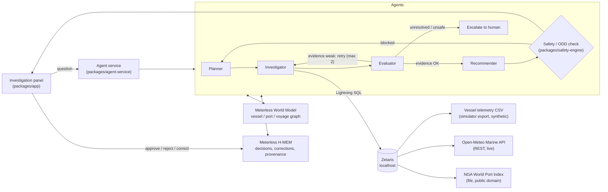

# MARTEX: Explainable Berth-Risk Agent

**Open Agent Hackathon 2026, Track 2: "The Agent That Can Explain Why"**
Solo build: Manoj Rajan (team MARTEX)
Status: design draft, 22 Oct 2026. Items marked **VERIFY** are assumptions to confirm during the build.

---

## 1. Problem and user

**User:** a shore-side vessel operations manager (fleet operations / voyage desk) responsible for several container vessels.

**Problem:** when a vessel starts drifting from its berth window, the evidence is spread across systems. Vessel telemetry and noon reports sit in one place, marine weather in another, and port information in a third. The manager has to piece it together by hand, and any recommendation (speed up, re-sequence, notify the terminal) is hard to justify afterwards.

**What MARTEX does:** it investigates *why* a vessel is at risk of missing its berth window, gives evidence-backed options, checks each option against deterministic safety rules, and sends the decision to a human. Every conclusion links back to the queries and rows it came from.

### Questions the agent must answer (demo scenarios)
1. "Why is vessel MV-ATLAS at risk of missing its Jebel Ali berth window, and what should we do?"
2. "Fuel consumption on MV-ORION rose 9% in 48 hours. Why, and does it change the ETA?"
3. "Should MV-ATLAS increase speed to recover the window, given the weather ahead and the engine condition?"

---

## 2. What is pre-existing and what is new

| Area | Status | Notes |
|---|---|---|
| `packages/app` (UI), `core-domain`, `decision-engine`, `safety-engine`, `simulator`, `assurance` | **Pre-existing, declared** | Git tag `pre-hackathon-baseline` (commit 84b68f2). See `PREEXISTING.md`. |
| Zetaris data layer (sources, views, federated query) | **New** | |
| Agent service (Planner, Investigator, Evaluator, Recommender) | **New** | Core of what is judged |
| Meterless World Model and H-MEM, implemented from their specs | **New** | |
| Investigation panel in the UI, plus the human-decision feedback loop | **New** | Reuses the existing ODD approval gate |
| Fallback sample mode, traces, README, metadata.json | **New** | |

---

## 3. Architecture

### Shared state
One `Investigation` object is passed between agents. It holds: the question, the plan, the queries run (SQL text, row counts, timestamps), the evidence items (each with source and row reference), the critique notes, the options, the safety verdicts and the final recommendation. It is persisted as the run trace.

---

## 4. Data layer (Zetaris)

| Source | Type | Licence | Role |
|---|---|---|---|
| Vessel telemetry and noon-report extract | CSV/Parquet exported from `packages/simulator` | Synthetic, own work (pre-existing generator; the export is new) | Speed, fuel, engine alarms, position, ETA |
| Open-Meteo Marine Weather API | REST (live) | Free for non-commercial use; data CC BY 4.0, attribution required | Wave height, wind and swell along the route |
| NGA World Port Index (Pub. 150) | File (download, then CSV) | US Government, public domain | Port depth, facilities, restrictions, coordinates |

**Zetaris objects (names to keep consistent):**
- Lightning database `MARTEX_REST` (Open-Meteo)
- Schemastore container `martex`
- Tables or views: `martex.vessel_telemetry`, `martex.port_index`, `martex.marine_weather`
- Federated view `martex.voyage_risk_context`: joins telemetry, the destination port and the weather at upcoming waypoints

**Access from Node:** the Zetaris HTTP API, through the helper pattern in `~/zetaris/getting-started/scripts/` (**VERIFY**: HTTP API vs JDBC from Node. If only JDBC works, run a small Python sidecar using the existing `zetaris_jdbc.py`).

**Network note:** some Cloudflare routes stall from this machine. Prefer file sources, cache REST responses, and run the MTU A/B test before relying on any new REST source.

---

## 5. Agents

| Agent | Responsibility | Inputs | Outputs |
|---|---|---|---|
| **Planner** | Breaks the question into sub-questions and evidence needs; re-plans when Safety blocks an option | Question, World Model context, relevant H-MEM memories | Plan (ordered steps) |
| **Investigator** | Writes and runs Lightning SQL against Zetaris, one statement per call; records evidence with row references | Plan step | Evidence items, query log |
| **Evaluator** | Critiques the evidence: coverage, contradictions, freshness, unsupported claims. Sends weak evidence back to the Investigator (max 2 retries), then escalates | Evidence, plan | Pass / retry / escalate, with reasons |
| **Recommender** | Builds 2–3 options with an expected effect on ETA, fuel and risk, each citing its evidence | Validated evidence | Options |
| **Safety / ODD check** (existing engine) | Deterministic validation of each option against ODD limits and L0–L4 assistance levels | Options | Allowed / blocked, with rule IDs |

**Strong-agent criteria this design meets:** dynamic re-planning, a critique loop with retries, escalation, shared state, specialised roles, and traceable evidence.

**Model:** provider set through `.env`. Candidate: NVIDIA Nemotron through the NVIDIA API (**VERIFY** access and free credits), which counts toward the NVIDIA criterion. Another provider is the fallback.

---

## 6. Meterless

| Engine | Use in MARTEX | Evidence for judges |
|---|---|---|
| **World Model** | Persistent graph of Vessel, Port, Voyage, WeatherWindow and Incident entities and their relationships (`bound_for`, `exposed_to`, `affected_by`). Loaded from Zetaris query results. The Planner reads it for context | Conformance suite passing; graph shown in the trace |
| **H-MEM** | Stores human decisions, corrections and outcomes, with provenance. On the next investigation, relevant memories are retrieved, e.g. "the operator rejected speed-up in Hs > 3.5 m last time" | Ledger trace answering "why did the agent suggest X?" |

Implementation: `npx degit meterless/meterless/engines/<engine>`, then build in `packages/meterless-*` following each engine's `AGENTS.md` until its conformance suite passes.

---

## 7. Human in the loop

The existing ODD approval gate shows the recommendation with its evidence and safety verdict. The operator can **approve**, **reject** or **correct** it. The outcome is written to H-MEM with the operator ID and a timestamp. No action is executed automatically.

---

## 8. Runtime (local, 8 GB PC, 6 GB for WSL)

| Component | Address |
|---|---|
| Zetaris UI / API / JDBC | `localhost:3000` / API **VERIFY** / `localhost:10000` |
| Agent service | `localhost:8787` |
| UI dev server | `localhost:5173` |

The model runs remotely through an API, so nothing large runs locally. Close other apps during demos.

---

## 9. Security and reproducibility
- Credentials only in `.env`; `.env.example` holds placeholders; `.env` is listed in `.gitignore`.
- `SAMPLE_MODE=true` replays recorded Zetaris results and model responses, so judges can run the demo with no credentials and no network.
- At least 3 recorded scenarios with inputs, outputs and full traces in `samples/`.

---

## 10. How this maps to the judging criteria

| Criterion (points) | How MARTEX answers it |
|---|---|
| Impact (30) | Real operational decision, named user, cost of a missed berth window |
| Technical (20) | Critique loop, retries, escalation, deterministic safety layer, tests |
| Innovation (15) | AI recommendations bounded by deterministic ODD rules; memory of human decisions |
| Demo (15) | 3 scripted scenarios, live plus sample mode |
| Product & UX (10) | Investigation panel inside an existing operations UI |
| Sponsor Tech (10) | Zetaris federates 3 sources; Meterless World Model + H-MEM; built in Cursor; Nemotron if available |

---

## 11. Risks and open items

| Risk | Mitigation |
|---|---|
| Cursor credit not yet issued | Do non-AI tasks first; escalate in Help Cursor |
| Zetaris HTTP API from Node not confirmed | Python JDBC sidecar fallback |
| Live REST stalls (network/MTU) | Cache responses; sample mode; run the MTU A/B test |
| 6 GB memory | Remote model; small datasets (a few thousand rows) |
| Open-Meteo free-tier terms | Non-commercial demo; attribution in README and UI |
| World Port Index file format | **VERIFY** download format; convert to CSV with a script |
| Solo scope | Cut order: H-MEM depth, then the 3rd scenario, then UI polish. Never cut traces or sample mode |

---

## 12. Plan (Dubai time; deadline 28 Oct 03:45, target submission 27 Oct 20:00)

| Day | Deliverable |
|---|---|
| 22 Oct | Baseline tag ✅, architecture doc, 3 sources registered in Zetaris, `voyage_risk_context` returns rows |
| 23 Oct | Agent service with all 4 agents, traces, model provider |
| 24 Oct | World Model + H-MEM; approvals write memory |
| 25 Oct | Investigation panel in the UI; sample mode |
| 26 Oct | 3 scenarios end to end, tests, README, metadata.json, .env.example |
| 27 Oct | Demo video (1–4 min), deck, submit |